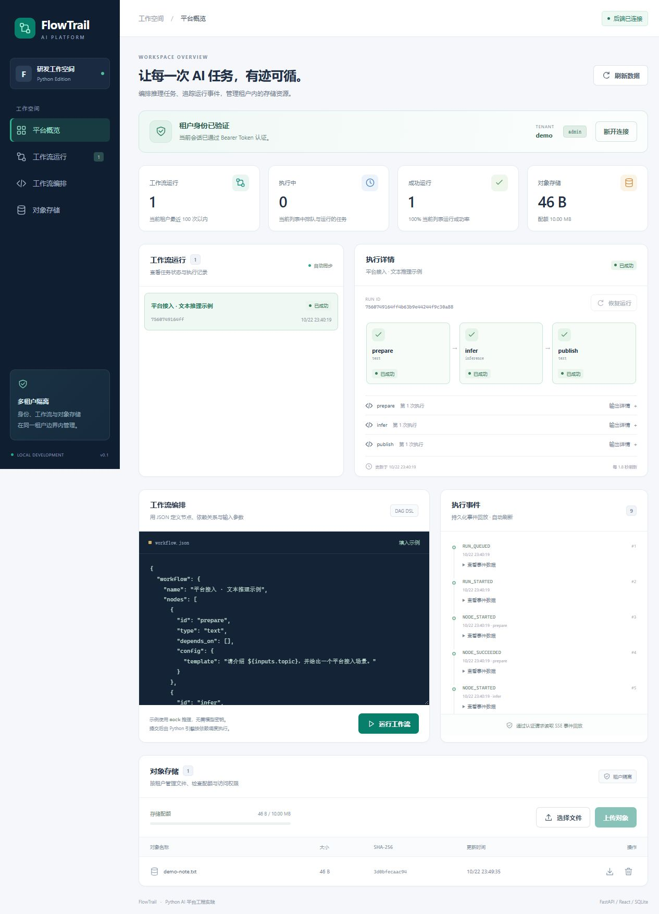

# FlowTrail Python

[English](README.md) | [简体中文](README_ZH.md)

**A Python AI task platform with tenant-scoped access, recoverable DAG execution, and a React operations console.** Submit text, read-only HTTP, and inference tasks; inspect persisted events; and manage small objects within a tenant quota.

**中文简介：** 基于 Python、FastAPI 和 React 的单机 AI 任务平台，支持租户鉴权、DAG 编排、检查点恢复、事件回放与对象配额管理。



*Actual console screenshot. The demonstration uses explicitly labeled mock inference; task execution, persistence, and event replay use the application runtime.*

## What it does

| Capability | Implemented behavior |
| --- | --- |
| Tenant access | Random bearer tokens bind a tenant and role on the server; only SHA-256 token hashes are stored |
| Workflow execution | Validated DAGs with `text`, `http`, and `inference` nodes; bounded concurrency and node deadlines |
| Recovery | Successful node checkpoints survive restart; unfinished nodes run again under a new attempt number |
| External integration | HTTP nodes call exact server-configured GET endpoints; model nodes use a fixed OpenAI-compatible configuration |
| Event replay | SQLite-backed SSE with per-run sequence IDs and `Last-Event-ID` replay |
| Object management | Tenant-scoped SQLite BLOB objects with an atomic byte quota check and write |
| React console | Workflow templates, run inspection, event history, object upload/download, and quota display |

This is a focused Python continuation of [FlowTrail Server](https://github.com/cloudwallker/flowtrail-server). It targets reproducible local demonstrations of platform APIs, automation, inference integration, and authorization.

## Quick start

Requirements: **Python 3.11+** and **Node.js 22.12+**. Run commands from this repository root. A virtual environment is recommended; activate it before installing dependencies.

```sh
python -m venv .venv
# Linux/macOS: source .venv/bin/activate
# PowerShell: .\.venv\Scripts\Activate.ps1
python -m pip install -e '.[test]'

cd frontend
npm ci
npm run build
cd ..

python -m flowtrail bootstrap --tenant demo --role admin
python -m flowtrail serve --host 127.0.0.1 --port 8000
```

`bootstrap` prints one newly generated token. Save it locally and paste it into the console at **http://127.0.0.1:8000**. There is no built-in account or default token. The browser keeps the token in memory; a page reload requires entering it again.

The backend serves `frontend/dist` when that directory exists at startup. Build the frontend before starting the backend, or restart it after the build. The database defaults to `data/flowtrail.sqlite3`, relative to the working directory.

For frontend development, run the backend on port 8000 and, in another terminal:

```sh
cd frontend
npm ci
npm run dev
```

Open **http://127.0.0.1:5173**. Vite proxies `/api` and `/healthz` to the backend; authentication still happens in the backend. API documentation is available at **http://127.0.0.1:8000/docs**.

## Submit and inspect a workflow

Set `FLOWTRAIL_API_TOKEN` in your terminal to the token printed locally by `bootstrap`. The following examples use a POSIX shell and `curl`; they contain no real credentials.

```sh
curl --fail-with-body http://127.0.0.1:8000/api/me \
  -H "Authorization: Bearer $FLOWTRAIL_API_TOKEN"

curl --fail-with-body -i http://127.0.0.1:8000/api/runs \
  -H "Authorization: Bearer $FLOWTRAIL_API_TOKEN" \
  -H 'Content-Type: application/json' \
  -H 'Idempotency-Key: report-demo-1' \
  --data-binary @examples/report-workflow.json
```

The second request returns **202 Accepted**, a `Location` header, and a run with an `id`. Reusing the same idempotency key and request within a tenant returns the same run; a changed request returns 409.

```sh
RUN_ID=replace-with-the-returned-run-id

curl --fail-with-body "http://127.0.0.1:8000/api/runs/$RUN_ID" \
  -H "Authorization: Bearer $FLOWTRAIL_API_TOKEN"

curl --fail-with-body "http://127.0.0.1:8000/api/runs/$RUN_ID/events?follow=false" \
  -H "Authorization: Bearer $FLOWTRAIL_API_TOKEN"

curl --fail-with-body "http://127.0.0.1:8000/api/runs/$RUN_ID/events?follow=false" \
  -H "Authorization: Bearer $FLOWTRAIL_API_TOKEN" \
  -H 'Last-Event-ID: 3'
```

`follow=false` returns the available event history and closes. The default follow mode waits for new events until the run finishes or the connection reaches its approximately one-minute lifetime. Reconnect with the last event ID for further events, including an explicit resume.

The [report example](examples/report-workflow.json) executes a preparation node, two independent mock inference branches, and one joining report node. Templates support `${inputs.topic}` and `${nodeId.output}` for ancestor nodes. Substitution happens once, with a UTF-8 byte budget; expressions are never evaluated.

## API and permissions

All business APIs require `Authorization: Bearer …`. Tenant identity comes from the token; callers cannot choose another tenant through a request field or query parameter. A foreign run or object returns 404, including event history.

| API | Purpose | Roles |
| --- | --- | --- |
| `GET /api/me` | Current tenant and role | All |
| `GET /api/runs` | Most recent 100 runs in the tenant | All |
| `POST /api/runs` | Submit a workflow and inputs | admin, operator |
| `GET /api/runs/{id}` | Definition, node attempts, outputs, and status | All |
| `POST /api/runs/{id}/resume` | Resume a failed or interrupted run | admin, operator |
| `GET /api/runs/{id}/events` | SSE event history and follow | All |
| `GET /api/objects` | List tenant objects | All |
| `PUT /api/objects/{name}` | Create or replace an object using raw bytes | admin, operator |
| `GET /api/objects/{name}` | Download object bytes | All |
| `DELETE /api/objects/{name}` | Delete an object | admin, operator |
| `GET /api/quota` | Used, allowed, and remaining object bytes | All |
| `GET /healthz` | Public health check | No token required |

`admin` and `operator` currently have the same API write permissions; `viewer` is read-only. Token issuance is a local management CLI operation. You can issue a viewer token with `python -m flowtrail bootstrap --tenant demo --role viewer`.

Object names use ASCII letters, digits, dot, dash, or underscore and start with a letter or digit. The default object limit is **5 MiB** and the default tenant object quota is **10 MiB**. Replacing an object accounts for its new size inside the same SQLite transaction. Quota measures object contents only; it does not measure database files, indexes, workflow history, or filesystem capacity.

## Server configuration

Configuration is read from the process environment. An `.env` file is not loaded automatically.

| Variable | Default or purpose |
| --- | --- |
| `FLOWTRAIL_DB` | `data/flowtrail.sqlite3` |
| `FLOWTRAIL_QUOTA_BYTES` | `10485760`; initial quota for newly created tenants |
| `FLOWTRAIL_MAX_OBJECT_BYTES` | `5242880` |
| `FLOWTRAIL_MAX_PENDING_RUNS` | `100`; global queued plus running limit |
| `FLOWTRAIL_MAX_PARALLEL_RUNS` | `4` |
| `FLOWTRAIL_MAX_PARALLEL_NODES` | `8`; global node concurrency |
| `FLOWTRAIL_PER_RUN_PARALLELISM` | `4` |
| `FLOWTRAIL_CONNECTORS_JSON` | `{}`; exact server-controlled GET URLs and optional headers |
| `FLOWTRAIL_MODEL_BASE_URL` | OpenAI-compatible base URL, usually ending in `/v1` |
| `FLOWTRAIL_MODEL_NAME` | Fixed server model identifier |
| `FLOWTRAIL_MODEL_API_KEY` | Server credential, provided locally through the environment |
| `FLOWTRAIL_FRONTEND_DIR` | `frontend/dist` |

To try [the HTTP workflow](examples/http-workflow.json), configure a read-only connector before starting the server:

```sh
export FLOWTRAIL_CONNECTORS_JSON='{"demo-health":{"url":"http://127.0.0.1:8000/healthz"}}'
python -m flowtrail serve
```

An HTTP node selects `{"connector":"demo-health"}`. It cannot supply a URL, method, header, or path. Requests use GET, disable redirects and environment proxies, and enforce response-size and deadline limits. Operators configuring connectors must choose endpoints whose GET requests are safe to repeat.

Inference nodes default to `"mode":"mock"`, which returns a clearly labeled deterministic response. To use `"mode":"live"`, configure all three model environment variables. The adapter calls `BASE_URL/chat/completions` with the fixed model and collects a complete response. Configuration or provider errors fail the node explicitly. Verification uses a local protocol fixture; no real public model provider was called during the recorded checks. SSE carries run and node events, rather than token-by-token model output.

## Recovery and resource boundaries

- **One serving process owns one local SQLite database.** An OS-level exclusive lock rejects a second server using the same database. Use local storage and one Uvicorn worker.
- Node results and their events commit together. Startup recovers queued and interrupted work, preserving successful checkpoints. A failed run requires an explicit resume; successful nodes are retained while unfinished nodes are reset.
- Failed nodes are not automatically retried. Each node may execute at most five times across recovery and explicit resume. Each execution cycle has a 300-second run deadline; node deadlines default to 10 seconds and accept 0.05–120 seconds.
- A failed node prevents downstream work from starting; already submitted independent work settles before the run finishes. Graceful shutdown cancels active work and records interruption.
- DAGs contain at most 32 nodes. Request bodies, rendered templates, upstream responses, and node outputs have bounded sizes; the default non-object request and output limit is 256 KiB.
- A cancelled or interrupted remote inference request may continue upstream. Recovery can send it again and incur another charge. The platform cannot retract a remote request.

The implementation uses SQLite BLOBs as a small object service. It does not implement distributed object storage, S3, MySQL recovery, multi-instance high availability, or HTTP write reconciliation. The original Java project's measurements and tests do not describe this Python version.

## Verification

```sh
python -m unittest discover -s tests -v
python scripts/smoke.py

cd frontend
npm test
npm run build
```

The 2026-10-22 local verification passed **29 backend tests** and **7 frontend tests**. Backend coverage includes tenant isolation across runs/events/objects, roles, concurrent quota writes, malformed DAGs, idempotency conflicts, deadlines, explicit resume, process ownership, and bounded template expansion.

The smoke script starts real local processes, creates temporary credentials and a database, forcibly terminates the server after a successful checkpoint, and restarts it. It verifies one call to the completed node, another attempt for the unfinished node, persistent object contents, event replay, and request idempotency. It prints a result summary without the access token.

The repository includes a multi-stage [Dockerfile](Dockerfile) that builds the React console and runs the Python service as an unprivileged user. The Docker image was **not built or run** during this verification. Persist `/app/data` if you use that deployment configuration.

## Source map

| Entry | Responsibility |
| --- | --- |
| `src/flowtrail/app.py` | HTTP API, authentication dependencies, body limits, SSE, and static console |
| `src/flowtrail/models.py` | DAG validation and bounded one-pass template rendering |
| `src/flowtrail/runtime.py` | Scheduling, concurrency, deadlines, and HTTP/model adapters |
| `src/flowtrail/store.py` | Transactions, checkpoints, events, idempotency, objects, and quotas |
| `src/flowtrail/locking.py` | Exclusive database ownership by one server process |
| `src/flowtrail/__main__.py` | Token bootstrap and server CLI |
| `frontend/src/` | React operations console and API client |

## Origin and license

This project continues the workflow concepts of the author's [Java FlowTrail Server](https://github.com/cloudwallker/flowtrail-server), with new Python source written with AI coding assistance. It is a focused implementation; source code and the checks above define its current capabilities. See [NOTICE](NOTICE) for the reference revision and attribution.

The original contributor notice is retained in [LICENSE](LICENSE), and project code uses the MIT license. Dependencies retain their own licenses and are installed separately.
